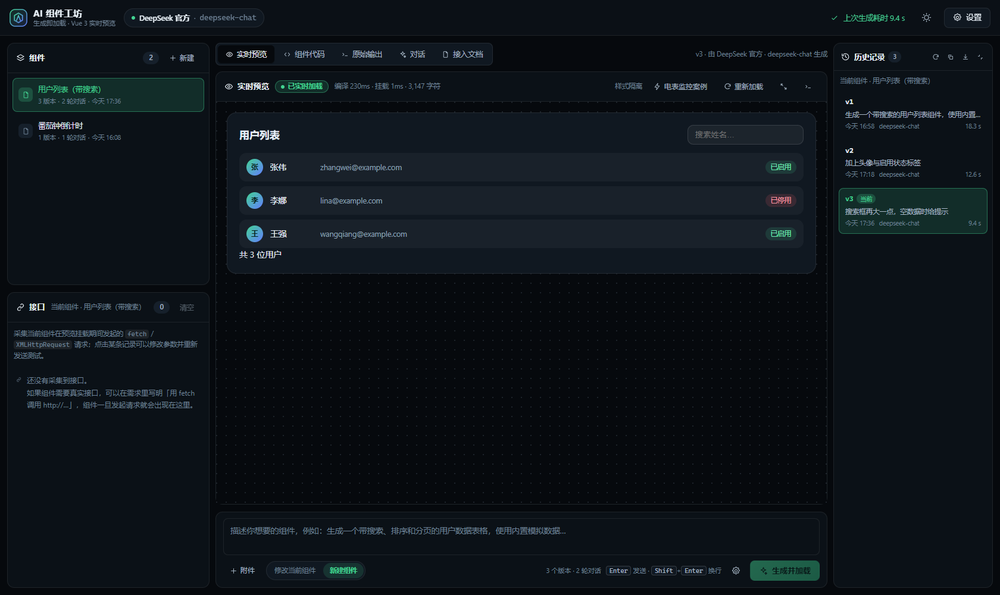
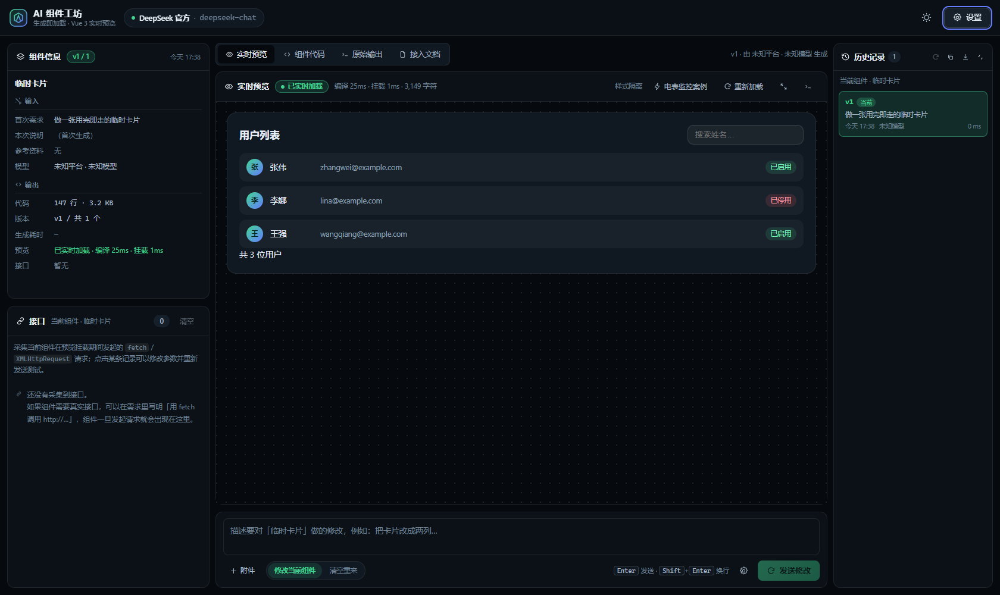
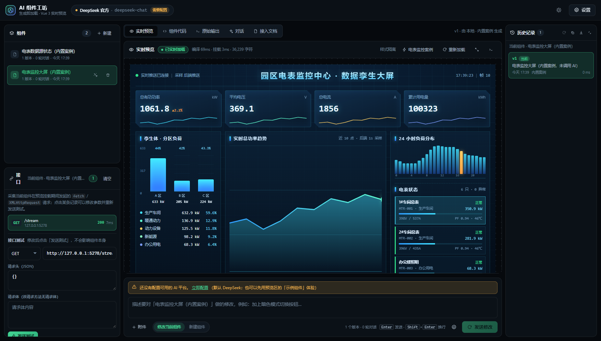
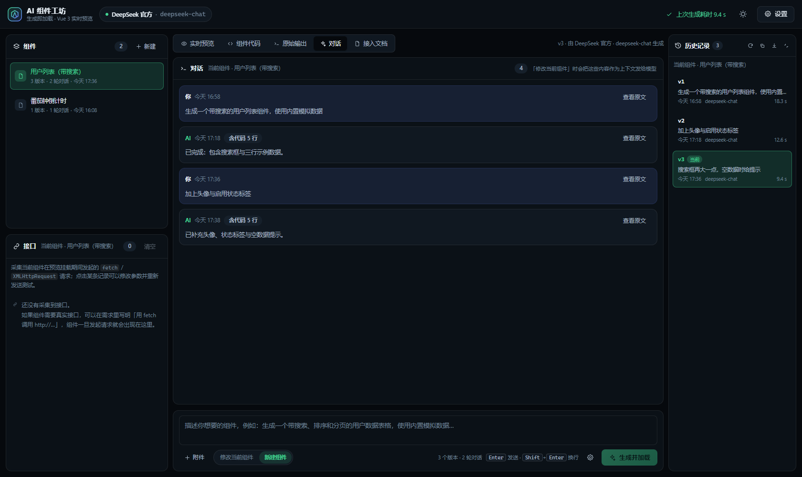
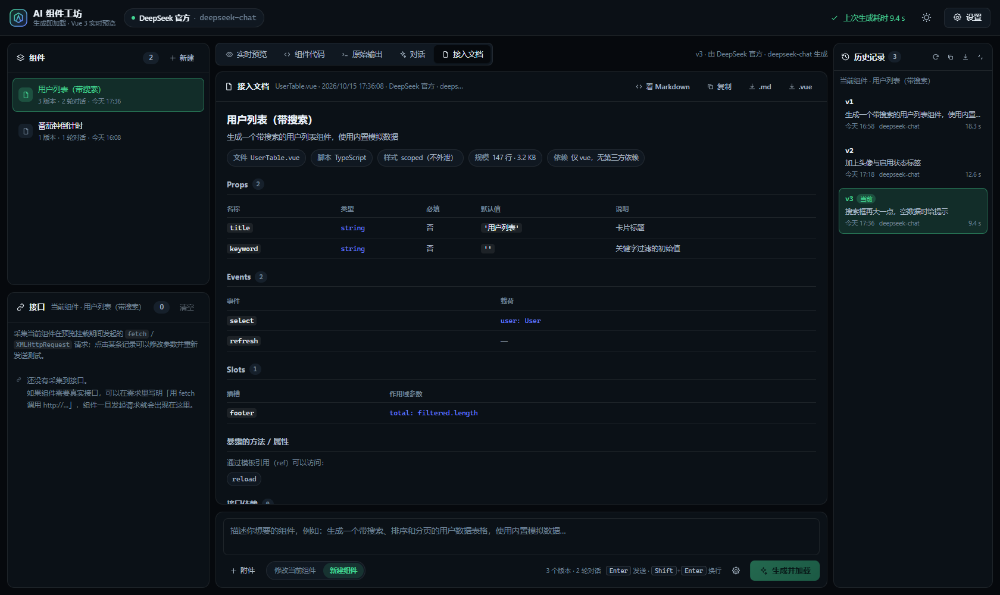
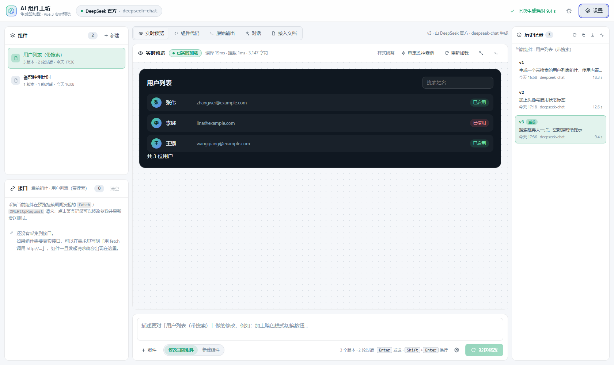
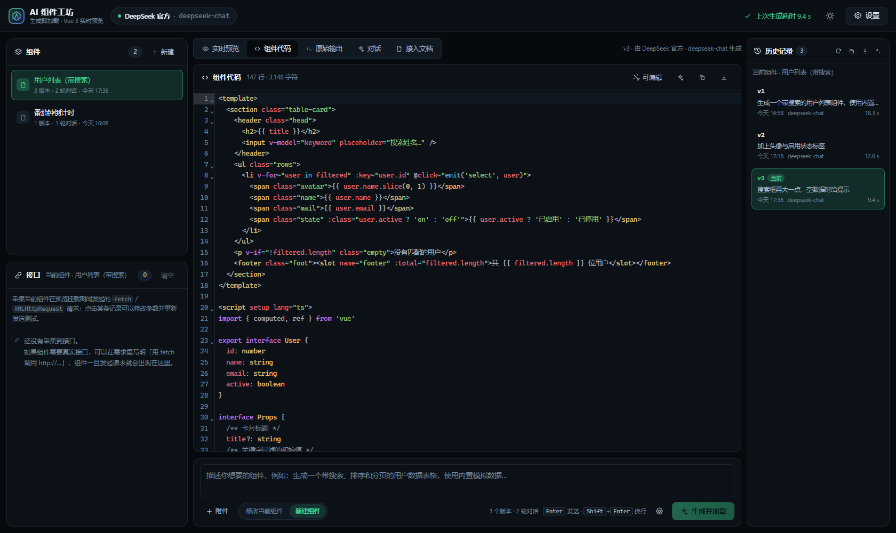
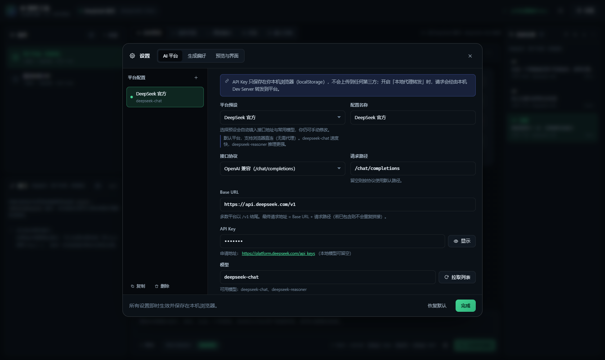

# AI 组件工坊（AI Component Studio）

用一句话描述界面 → AI 直接产出 **Vue 3 单文件组件** → **在当前网页里实时编译、挂载、运行**。

不是「生成代码让你复制粘贴」，而是生成即加载：代码一边从模型流式返回，页面一边把它编译挂载到你已经打开的这个网站里，改一行字预览立刻跟着变。

两种工作形态是两个独立路由页面，直接用地址访问：

<p align="center">
  
  
</p>

---

## 🔀 两种工作形态（两个独立路由页面）

| | 🗂 **项目模式** | ⚡ **临时模式（用完即走）** |
| --- | --- | --- |
| 路由 | `#/project`（默认） | `#/scratch` |
| 页面组件 | `src/views/ProjectWorkspace.vue` | `src/views/ScratchWorkspace.vue` |
| 构建产物 | `dist/assets/workspace-project-*.js` + `.css` | `dist/assets/workspace-scratch-*.js` + `.css` |
| 左栏 | **组件列表**，可同时管理多个组件 | **组件信息**：当前组件的输入 / 输出 |
| 对话 | 每个组件单独保留多轮对话，修改时作为上下文发给模型 | 不保留，每次都是单轮 |
| 版本历史 | 每个组件自己的版本历史，可随时切回 / 回退 | 只保留最新一版（会话内可切，刷新后只剩最后一版） |
| 对话框 | 修改当前组件 / **新建组件**（已有组件不受影响） | 修改当前组件 / **清空重来**（二次确认后丢弃草稿） |
| 适合 | 正经做一个组件库、需要反复迭代 | 临时试一个效果、看完就走 |
| 数据 | `acs.project.v1`（本机浏览器） | `acs.scratch.v1`（本机浏览器） |

- 两个页面共享一组叶子面板（预览 / 代码 / 原始输出 / 接入文档 / 接口 / 版本历史），它们被抽到公共 chunk `workspace-shared`，因此**两个形态的产物互不依赖**：只访问 `#/project` 不会下载临时模式的 chunk，反之亦然（`pnpm verify:build` 会实测这一点）。
- 用 hash 路由是为了让 `dist/` 丢到任意静态服务器（甚至本地直接打开）都能跑，不需要服务端 history fallback。
- 顶部栏不放置切换按钮：直接访问对应地址即可（可收藏、可分享）；打开 `#/` 会回到你上次用的形态。
- 两套数据互不干扰：切到临时模式时项目里的组件原封不动；临时模式生成的组件也不会污染项目。**两者都只存在你自己的浏览器里，不经过任何服务器。**

---

## ✨ 功能特性

| 能力 | 说明 |
| --- | --- |
| **单组件工作台 + 版本历史** | 一次只开发一个组件：左上显示它的输入/输出信息，最右是它的版本历史。只提供「修改当前组件」与「新建组件」两种操作，不做多组件管理 |
| **两种工作形态（两个路由页面）** | `#/project` 项目模式：多组件 + 每组件独立对话 + 版本历史；`#/scratch` 临时模式：用完即走，只保留最新一版。两者是两个页面级组件，构建时各自打成独立 chunk，共享面板放在公共 chunk |
| **生成即加载** | 采用 `vue3-sfc-loader`（内含 `@vue/compiler-sfc` 浏览器构建）在浏览器内编译 SFC，并复用宿主应用的 Vue 实例挂载，**不是 iframe**，生成组件与当前网站共享同一套响应式系统 |
| **内置默认案例** | 预览区一键载入「电表监控」数据孪生大屏（+ 配套数据源卡片）：连得上后台模拟推送服务就走 SSE 实时刷新，连不上就自动降级为组件内模拟，离线也能完整演示；配套 `scripts/meter-simulator.mjs` 提供 SSE / 快照 / 回放 / 健康检查四个端点 |
| **流式实时预览** | SSE 流式接收，代码闭合后自动编译挂载；解析失败时保留上一次成功的结果，不会白屏 |
| **对话可追溯** | 项目模式下每个组件的多轮对话都会记下来（含代码行数、可查看原文），修改时一并作为上下文发给模型 |
| **自动接入文档** | 每个组件都有一份从源码静态提取的接入文档：props（类型/必填/默认值/注释说明）、事件与载荷、插槽与作用域参数、`defineExpose`、依赖与实测接口、可直接粘贴的使用示例；支持一键复制 Markdown 与下载 `.md` / `.vue` |
| **输入/输出可追溯** | 左栏把「这个组件是怎么来的」记清楚：首次需求、本次修改说明、参考资料、模型；以及代码行数、版本、耗时、预览状态、接口数量 |
| **可接入任意 AI 平台** | 默认 DeepSeek，内置 11 个平台预设，任意 OpenAI 兼容接口 / Anthropic Messages 接口都能接；支持自定义路径、模型、温度、请求头 |
| **自定义平台管理** | 多套配置并存、一键套用预设、一键「拉取模型列表」、一键「测试连通性」 |
| **绕过 CORS** | 内置开发服务器代理中间件：浏览器直连被平台拦截时，一次开关即可改为由本机转发 |
| **样式隔离** | 预览默认运行在 Shadow DOM 中，生成组件的样式不会污染本站；可切换为直接挂载模式 |
| **可编辑 + 实时跟随** | 内置 CodeMirror 6（Vue 语法高亮），手动改代码会写回当前版本并即时刷新预览 |
| **修改当前组件** | 对话框里的「修改当前组件」会把**当前代码**一并发给模型，改动基于最新版本而不是靠模型记忆 |
| **参考资料附件** | 对话框支持添加文件（接口文档、类型定义、设计说明等文本文件），内容随需求一起发给模型 |
| **接口管理** | 自动采集当前组件在挂载期间发起的 `fetch` / `XMLHttpRequest`，按 `method + url` 合并统计，点开即可改参数**重新发送测试** |
| **预览控制台** | 采集生成组件内的 `console` 输出、编译错误、运行期异常与 `unhandledrejection` |
| **零后端** | 纯静态站点，API Key 只存在浏览器 `localStorage`，不经过任何第三方服务器（开启代理时仅经本机 Dev Server） |

---

## 🚀 快速开始

环境要求：Node.js ≥ 20.19（推荐 22/24），包管理器 pnpm（npm / yarn 亦可）。

```bash
# 1. 安装依赖
pnpm install

# 2. 启动开发服务器（默认 http://127.0.0.1:5273）
pnpm dev

# 3. 生产构建 / 本地预览构建产物
pnpm build
pnpm preview
```

打开页面后：

1. 点击右上角 **设置 → AI 平台**；
2. 在 **API Key** 里填入 DeepSeek 的 Key（[申请地址](https://platform.deepseek.com/api_keys)），点 **测试连通性** 确认可用；
3. 访问对应形态的地址（`#/project` 或 `#/scratch`，默认项目模式）；
4. 在右下角的 **对话框** 里描述需求，点击 **生成并加载**（或直接按 `Enter`）。

之后的用法取决于形态：

- **项目模式**：想调整就切到「修改当前组件」再发送，会生成 **v2、v3…**，右栏历史随时切回；想另起一个组件点「新建组件」，**已有组件不受影响**。
- **临时模式**：改了就点「发送修改」；想推倒重来点「清空重来」，确认后草稿丢弃，**只保留最新一版**。

没有 Key 也能先玩：点击预览区的 **载入「电表监控」大屏案例** / **载入内置示例组件**，可以完整体验「编译 → 挂载 → 交互」这条链路。

> **Windows 便捷入口**：不想配置环境变量的话，直接双击 **`start.cmd`** 即可（会自动定位 Node.js、首次运行自动装依赖并启动开发服务器）；
> 需要构建产物时双击 **`build.cmd`**（类型检查 → 生产构建 → 构建冒烟测试，一步到位）。

### 常用命令

| 命令 | 作用 |
| --- | --- |
| `start.cmd`（双击） | Windows 一键启动：定位 Node → 装依赖 → 起开发服务器 |
| `build.cmd`（双击） | Windows 一键构建：类型检查 → 构建 → 构建冒烟测试 |
| `pnpm dev` | 启动开发服务器（含 AI 代理中间件） |
| `pnpm build` | 构建静态产物到 `dist/` |
| `pnpm preview` | 预览构建产物（同样带 AI 代理中间件） |
| `pnpm typecheck` | `vue-tsc` 全量类型检查 |
| `pnpm verify:sfc` | 编译管线自检（Node + SSR 渲染 + 接入文档解析 27 项断言） |
| `pnpm verify:build` | 生产构建冒烟测试（静态托管 + 两个形态各自独立分包 + 按需分包 17 项断言） |
| `pnpm verify:e2e` | 端到端自检（真实浏览器 81 项断言，需要本机 Edge/Chrome） |
| `pnpm verify:meter` | 「电表监控」案例端到端自检（真实浏览器 + 真实推送 + 离线降级，需要本机 Edge/Chrome） |
| `pnpm meter:sim` | 单独启动后台电表数据模拟推送服务（默认 `127.0.0.1:5278`） |
| `node scripts/screenshot.mjs` | 输出界面截图到 `docs/` |

---

## 🔌 内置案例：电表监控（数据孪生大屏）

内置案例是「数据孪生大屏」这一类需求的默认起点：不用配 AI Key，点一下就能看到完整链路跑起来。

<p align="center">
  
</p>

### 怎么用

1. 起后台模拟推送服务（另开一个终端，保持运行）：

   ```bash
   pnpm meter:sim
   # 等价于：node scripts/meter-simulator.mjs
   # 可调参数：--port 5278 --interval 1000 --meters 6 --history 240 --persist .meter-state.json
   ```

2. 打开工作台，点预览区的 **载入「电表监控」大屏案例**（顶部预览栏也常驻这颗按钮）。

3. 左栏会出现两个内置组件：
   - **电表监控大屏** —— 数据孪生大屏本体，1s 一帧接收推送并实时刷新；
   - **电表数据源状态** —— 配套的「数据源」小卡片，显示后端服务的帧数、订阅数、采样间隔等指标。

> 后台服务没起也能演示：组件连不上 `127.0.0.1:5278` 时会自动降级为组件内模拟，
> 界面照常刷新，只是角标从「采样 后端推送」变成「采样 本地模拟」。这正是默认案例想同时演示的两条路。

### 大屏包含什么

| 区域 | 内容 |
| --- | --- |
| 顶部 | 标题 + 数据源连接状态（实时推送 / 本地模拟）+ 累计帧号 + 时钟 |
| KPI 条 | 总有功功率（带环比箭头）、平均电压、总电流、累计用电量，每张卡带迷你走势线 |
| 孪生体 · 分区负荷 | 按 A~F 分区聚合的立体柱状体，标出分区功率与负荷率，重载转黄、告警转红 |
| 实时总功率趋势 | SVG 面积折线，悬停出十字线与数值气泡，附峰值 / 均值 / 谷值 / 波动率 |
| 电能质量 | 三相不平衡度、平均功率因数、电压合格率三条健康度条 |
| 24 小时负荷分布 | 24 根柱状，当前小时高亮 |
| 电表状态 | 每只电表的电压 / 电流 / 功率因数 / 温度 / 负荷率，点击可选中，告警行闪烁 |
| 告警与事件 | 后端状态跳变（正常 ↔ 重载 ↔ 告警）自动落一条事件 |

### 后台模拟推送服务

`scripts/meter-simulator.mjs` 是一个零依赖的 Node 服务（只用内置模块），把「电表」模拟成有物理关系的设备：

- 按 24 小时负荷曲线（早高峰 / 午后高峰 / 夜间低谷、周末衰减）+ 一阶惯性 + 正态抖动生成有功功率；
- 由功率反推电流、由功率因数与电压跌落反推温度，累计电量按真实时间积分；
- 约 0.4% 概率/帧进入告警（功率掉档、功率因数下降、电压跌落），持续若干帧后自愈；
- 随机种子固定（`--seed`），因此同一时刻的数据形态可复现。

| 端点 | 说明 |
| --- | --- |
| `GET /stream` | **SSE 实时推送**，每帧一条 `data: {ts, tick, meters:[…]}`（带 15s 心跳注释） |
| `GET /api/meters` | 当前一次快照（JSON） |
| `GET /api/replay?limit=60` | 最近 N 个历史采样点（总量 / 平均功率因数 / 平均电压 / 累计电量） |
| `GET /api/health` | 健康检查：运行时长、已推送帧数、在线订阅数、电表数量、历史点数 |
| `GET /api/events` | 最近的事件列表 |

响应带 `Access-Control-Allow-Origin: *`，因此**任何端口的页面都能直接订阅**（这正是大屏组件能直连它的原因）；
端口被占用时它会自动顺延到下一个端口并在日志里说明——此时记得同步改组件里的 `LIVE_BASE`。

组件对后端发起的 `/stream`、`/api/health` 请求会被工作台的 **接口** 面板自动采集，可以改参数后「发送测试」复现。

### 自检

```bash
pnpm verify:sfc     # 27 项：内置案例能被编译 + SSR 渲染，且只依赖 vue
pnpm verify:meter   # 22 项：真实浏览器 + 真实 SSE 推送 + 接口采集 + 停服自动降级
```

---

## 🔌 接入 AI 平台

### 内置预设

| 预设 | 协议 | 默认地址 | 浏览器直连 |
| --- | --- | --- | --- |
| **DeepSeek 官方**（默认） | OpenAI | `https://api.deepseek.com/v1` | ✅ 支持 |
| OpenAI | OpenAI | `https://api.openai.com/v1` | ❌ 需代理 |
| Anthropic Claude | Anthropic | `https://api.anthropic.com` | ❌ 需代理 |
| Moonshot 月之暗面 | OpenAI | `https://api.moonshot.cn/v1` | ✅ 支持 |
| 智谱 GLM | OpenAI | `https://open.bigmodel.cn/api/paas/v4` | ✅ 支持 |
| 阿里云百炼（通义千问） | OpenAI | `https://dashscope.aliyuncs.com/compatible-mode/v1` | ✅ 支持 |
| 硅基流动 SiliconFlow | OpenAI | `https://api.siliconflow.cn/v1` | ✅ 支持 |
| OpenRouter | OpenAI | `https://openrouter.ai/api/v1` | 视上游而定 |
| Ollama（本地） | OpenAI | `http://127.0.0.1:11434/v1` | 需 `OLLAMA_ORIGINS=*` |
| LM Studio（本地） | OpenAI | `http://127.0.0.1:1234/v1` | ✅ 支持 |
| 自定义平台 | OpenAI / Anthropic | 自行填写 | 自行确认 |

> 「浏览器直连」是实测结果（对平台发起带 `Origin` 的 CORS 预检请求）。被拦截的平台默认已帮你打开「经由本地开发服务器转发」。

### 接入一个完全自定义的平台

在 **设置 → AI 平台** 中：

1. **平台预设** 选「自定义平台」（或复制一份现有配置）；
2. **接口协议** 选 `OpenAI 兼容`（`POST {base}/chat/completions`）或 `Anthropic Messages`（`POST {base}/v1/messages`）；
3. 填写 **Base URL**（多数平台以 `/v1` 结尾）与 **请求路径**（留空用协议默认值）；
4. 填写 **API Key**、**模型名**（可点「拉取列表」自动获取）；
5. 需要时展开 **额外请求头**，用 JSON 传入平台要求的小众头部，例如 `{"X-Api-Version":"2024-01-01"}`；
6. 点 **测试连通性**，看到「连通正常」即可回到主界面生成。

最终请求地址 = `Base URL` + `请求路径`；若 `Base URL` 已包含路径（例如直接粘贴了完整 URL），不会再重复拼接。

### CORS 与「本地代理转发」

浏览器里的 `fetch` 受同源策略约束。这个项目自带一个开发服务器中间件（`server/aiProxyPlugin.ts`）：

```
POST /__ai_proxy__   { url, method, headers, body }
→ 服务器端 fetch 目标平台 → 把响应（含 SSE 流）原样回传
```

打开开关后，浏览器只与本机 Dev Server 通信（同源，无 CORS），由 Node 进程去请求平台。**该端点只在 `pnpm dev` / `pnpm preview` 下存在**；如果要把产物部署到纯静态托管，需要自建一个等价的后端代理，再把这个开关指向它。

---

## 🧠 生成规范（决定「能不能当场跑起来」）

系统的约束写在 `src/services/prompts.ts` 里，核心是保证生成的代码**无构建、无依赖、可直接运行**：

- **固定输出单个组件**，不生成整站页面、不拆多文件；
- **脚本固定 `<script setup lang="ts">`（TypeScript）**，要求类型完整、禁止 `any`；
- 只输出一个 `<template>` + `<script setup lang="ts">` + `<style scoped>` 的单文件组件，代码块之外不写解释；
- **只允许 `import ... from 'vue'`**，禁止 element-plus / echarts / axios 等任何三方包（浏览器里无法解析裸模块名）；
- 不引用外部 CSS / 字体 / 图片 / 图标库，图标用内联 SVG 或 Unicode；
- 默认不发真实请求：优先用内置模拟数据把界面填满，并让交互真实可用；如果需求里明确要求调用某个接口，则使用原生 `fetch` 写完整地址（这些请求会被「接口管理」自动采集）；
- 若用户在需求里附带了参考文件，需要严格按资料中的接口定义、字段结构与文案实现，不得自行改名或臆造字段；
- 根元素宽度 `100%`，适配 360px ~ 1440px，避免 `100vw` 与固定 px 宽度；
- 视觉与交互质量要求（间距、圆角、阴影、hover/focus 反馈、空数据状态、过渡动画）；
- 组件总长度控制在 400 行以内。

> 「输出单个组件」与「TypeScript」是固定行为，界面上不提供切换，以保证生成结果能直接在浏览器中编译加载。
> 可在 **设置 → 生成偏好** 中调整的只有：是否 `scoped`、是否要求适配深色背景，以及**追加自定义要求**（会拼到系统提示词末尾，并可在弹窗里直接预览最终提示词）。

> 如果模型给出了不支持的依赖，预览区会明确报错：`不支持的外部依赖「element-plus」…`，而不是让你对着白屏猜。
> 在 **设置 → 预览与界面** 中开启「允许加载 http(s) 远程 ESM 模块」后，`import x from 'https://…'` 形式的远程模块会被下载并一起编译（这些模块内部的 `from 'vue'` 仍会复用宿主 Vue）。

---

## 🏗 实时加载是怎么实现的

```
用户输入需求
   │
   ├─ services/prompts.ts        组装系统提示词 + 对话历史
   ├─ services/aiClient.ts       fetch + SSE 解析（兼容 OpenAI / Anthropic / reasoning_content）
   │       └─ 无 CORS 环境时走 /__ai_proxy__
   │
   ├─ services/codeExtract.ts    从流式文本里提取 ```vue 代码块，判断标签是否闭合
   │
   ├─ services/sfcLoader.ts      vue3-sfc-loader 编译 SFC
   │       └─ moduleCache: { vue }  ← 生成代码里的 import 'vue' 直接复用宿主实例
   │
   ├─ services/previewManager.ts createApp(component).mount(预览容器)
   │       ├─ 样式注入 Shadow DOM 内的 <style> 容器（不污染本站）
   │       └─ 采集 errorHandler / warnHandler / console / window.onerror
   │
   └─ components/PreviewPanel.vue 状态展示：接收代码中 / 编译中 / 已实时加载 / 出错
```

几个关键取舍：

- **不用 iframe**：iframe 需要另一份 Vue 与另一套消息通道，且拿不到宿主的设计变量。Shadow DOM 既隔离样式，又让组件与本站共享同一个 Vue 运行时——所以生成的组件点一下按钮，状态是真的在变（`pnpm verify:e2e` 里就验证了 0 → 1）。
- **编译内核按需加载**：`vue3-sfc-loader`（约 1.86 MB）通过动态 `import()` 单独分包，只在第一次编译时才下载，首屏 JS 保持 773 KB。
- **流式期间只在代码闭合后编译**：避免把半截模板丢进编译器造成满屏红字；解析失败会保留上一次成功渲染的结果。

---

## 🖥 界面说明与快捷键

整体是「左栏管资源、中间干活、最右侧看版本」的三列布局（类似 Codex 的面板式工作台）；访问的地址决定左栏与对话的行为：`#/project` 是组件列表 + 对话，`#/scratch` 是组件信息 + 单草稿。

- **左栏上半（随模式变化）**
  - **项目模式：组件列表** —— 名称、版本数、对话轮数、最近更新时间；点一下切换当前组件，「新建」只是切到新建意图（生成成功后才新增组件，已有组件不受影响），还支持重命名与两次确认的删除。
  - **临时模式：组件信息** —— 顶部是组件名与 `v3 / 3` 版本角标；**输入**记录首次需求、本次修改说明、参考资料（文件名 + 体积）、平台与模型；**输出**记录代码行数与体积、当前版本号 / 总版本数、生成耗时、预览状态（含编译与挂载耗时）、已采集接口数，手动编辑过会标注。
- **左栏下半：接口（当前组件的接口）**
  - 采集当前组件在预览挂载期间发起的 `fetch` / `XMLHttpRequest`，展示方法、路径、域名、状态码、耗时，并按 `method + url` 合并计数。
  - 点击某条记录展开详情，可修改**方法 / 地址 / 请求头（JSON）/ 请求体**后点「发送测试」重发，下方显示状态码、耗时与响应内容。
  - 工作台自身的请求（调用 AI 平台、拉取模型列表、加载远程模块）被显式排除；换组件后会清空重新采集。
- **中间栏上部：实时预览 / 组件代码 / 原始输出 / 接入文档（项目模式还有「对话」）**五个标签页
  - **实时预览**：状态徽标、编译/挂载耗时、样式隔离模式、重新加载、全屏、预览控制台；
  - **组件代码**：CodeMirror 6 编辑器（Vue 语法高亮），可锁定/解锁、清理格式、复制、下载 `.vue`；手动编辑会写回当前版本并标注「已编辑」；
  - **原始输出**：模型返回的完整原文 + DeepSeek R1 等推理模型的思考过程 + 错误详情；
  - **接入文档**：见下方「接入文档」小节；
  - **对话**（仅项目模式）：当前组件的多轮对话，用户/AI 分色，助手消息折叠显示「含代码 N 行」并可按条「查看原文」；这些内容会在修改时作为上下文发给模型。
- **最右侧：历史记录（当前组件的历史，可收起）**
  - 默认以约 268px 的竖排侧栏挂在窗口右侧，列出 `v1 / v2 / v3…`：版本号、需求/修改说明、时间、模型、耗时，当前版本高亮并标「当前」。
  - 点任意版本即可切回并重新加载预览；还提供**回退**（退到上一个版本）、复制当前版本代码、下载 `.vue`、删除某个版本（至少保留一个）。
  - 点标题栏最右的收起按钮即可收成一条 44px 竖排窄条（竖排文字 + 版本数），点窄条再展开；宽度也能拖拽调整，收起状态会记住。
- **中间栏底部：对话框**
  - 输入需求或修改说明，`Enter` 发送、`Shift + Enter` 换行；
  - 模式开关：**修改当前组件**（把当前代码一并发给模型，产出新版本）；另一颗按钮随形态变化——项目模式是 **新建组件**，临时模式是 **清空重来**；
  - 附件 按钮或直接把文件拖进对话框即可添加参考资料；右侧还有「生成偏好」入口与版本数提示。
  - **所有「清空」类操作都要二次确认**：点一下先变成「确认清空 / 取消」，5 秒内没确认会自动收回（草稿与接口记录的清空都是如此）。
  - 附件仅支持文本类文件（`.vue/.ts/.json/.md/.css/.html/.csv/.yaml` 等，最多 8 个、单文件 40 KB、合计 120 KB，超出会截断并标注）。
- **快捷键**：`Ctrl/⌘ + Enter` 发送、`Ctrl/⌘ + ,` 打开设置、`Ctrl/⌘ + 1/2/3` 切换标签页、`Esc` 关闭设置。
- 两处分隔条都可拖拽调整左右栏宽度；窗口宽度小于 1080px 时自动改为上下布局。

<p align="center">
  
</p>

<p align="center">
  
</p>

---

## 📄 接入文档

每个组件都自带一份接入文档，**由代码静态分析生成**（不额外调用模型，因此永远和代码一致，也不花钱）：

| 小节 | 内容 |
| --- | --- |
| 基本信息 | 文件名（优先取代码里的 `defineOptions({ name })`）、脚本语言、是否 `scoped`、代码规模、依赖（正常应只有 `vue`）、远程模块 |
| Props | 名称、类型、是否必填、默认值（从 `withDefaults` / 运行时声明里取）、说明（取类型里的 `/** */` 或 `//` 注释） |
| Events | 事件名与载荷类型，同时支持 `defineEmits<{ (e: 'x', v: T): void }>()` 与数组写法 |
| Slots | 插槽名与作用域参数（从模板里的 `<slot>` 提取，也读 `defineSlots`） |
| 暴露的方法 / 属性 | `defineExpose({ ... })` 里的成员，说明可用模板 ref 调用 |
| 接口依赖 | 组件运行期**实测**请求过的接口（来自左栏「接口」面板） |
| 使用示例 | 可直接粘贴的 `<template>` + `<script setup>` 片段，必填 props、事件绑定、具名插槽都按实际契约生成 |

用法：

- **复制** → 直接把 Markdown 粘到你的 README / 组件目录里；
- **`.md`** → 下载 `组件名.接入文档.md`；
- **`.vue`** → 下载组件源码本身；
- 右上角 **看 Markdown / 看排版** 可切换「渲染好的表格」与「Markdown 源码」。

> 中文的组件名会保留在文档标题里，但示例代码中的标签名需要是合法标识符：优先用代码里的 `defineOptions({ name })`，否则退化为 `MyComponent`，你可以按需改名。

<p align="center">
  
  
</p>

<p align="center">
  
</p>

---

## 📁 目录结构

```
generate-component/
├─ start.cmd / build.cmd          Windows 一键启动 / 构建（ASCII 包装，文案在 scripts/launch.mjs）
├─ index.html                    入口（含首屏主题预设脚本）
├─ vite.config.ts                Vite 配置（@ 别名、端口、代理插件、两形态分包）
├─ server/aiProxyPlugin.ts       开发/预览服务器的 AI 代理中间件
├─ scripts/
│  ├─ launch.mjs                 start.cmd / build.cmd 的实际逻辑
│  ├─ meter-simulator.mjs        电表数据模拟推送服务（HTTP + SSE，内置案例的数据源）
│  ├─ verify-sfc.mjs             编译管线 + 接入文档解析自检（Node 环境）
│  ├─ verify-build.mjs           生产构建冒烟测试（静态托管 + 两个形态独立分包）
│  ├─ verify-e2e.mjs             端到端自检（真实浏览器 + 模拟 AI 平台）
│  ├─ verify-meter-e2e.mjs       「电表监控」案例端到端自检（真实推送 + 离线降级）
│  └─ screenshot.mjs             界面截图（输出到 docs/）
├─ src/
│  ├─ main.ts                    入口：挂载应用 + 注册路由
│  ├─ App.vue                    外壳：顶部栏 + RouterView + 全局弹窗（路由驱动工作形态）
│  ├─ router/index.ts            两条路由：#/project、#/scratch
│  ├─ views/
│  │  ├─ ProjectWorkspace.vue    项目模式页面（独立 chunk）
│  │  └─ ScratchWorkspace.vue    临时模式页面（独立 chunk）
│  ├─ config/
│  │  ├─ presets.ts              11 个平台预设 + 默认设置
│  │  ├─ demoComponent.ts        内置示例组件（离线体验用）
│  │  └─ demoMeter.ts            内置案例：电表监控大屏 + 数据源状态卡片
│  ├─ services/
│  │  ├─ aiClient.ts             流式对话客户端（OpenAI / Anthropic、错误文案、模型列表、连通测试）
│  │  ├─ prompts.ts              系统提示词、新建需求与「基于当前代码修改」的消息组装（含附件资料）
│  │  ├─ codeExtract.ts          从模型输出中提取 SFC
│  │  ├─ componentDoc.ts         接入文档：静态解析 props/emits/slots/expose/依赖并拼 Markdown
│  │  ├─ sfcLoader.ts            浏览器内 SFC 编译
│  │  └─ previewManager.ts       挂载 / 卸载 / 错误与控制台采集
│  ├─ stores/
│  │  ├─ settings.ts             平台配置与偏好（含工作模式，localStorage 持久化）
│  │  ├─ workspace.ts            两种模式的数据层：项目模式多组件（对话 + 版本）/ 临时模式单草稿
│  │  ├─ studio.ts               生成流程编排（流式、新建/修改、附件、切换模式）
│  │  └─ apiInspector.ts         接口采集（fetch / XHR 接管）与重发测试
│  ├─ components/
│  │  ├─ composers/              两个形态各自专属的对话框（各自分包）
│  │  │  ├─ ProjectComposer.vue  修改当前组件 / 新建组件
│  │  │  └─ ScratchComposer.vue  修改当前组件 / 清空重来
│  │  └─ ...                     共享面板：AppHeader / ComponentList / ComponentInfo /
│  │                             ConversationPanel / DocPanel / ApiInspectorPanel /
│  │                             VersionHistory / AttachmentChips / PreviewPanel /
│  │                             CodePanel / RawOutputPanel / SettingsDialog /
│  │                             ToastHost / AppIcon
│  ├─ composables/               useToast / useWorkspaceLayout / useAttachments
│  ├─ styles/global.css          设计系统（深浅色 CSS 变量）
│  └─ types/index.ts
├─ docs/                         README 截图
└─ dist/                         构建产物（pnpm build 生成）
```

---

## ✅ 自检

```bash
# 编译管线：内置示例组件、电表监控案例、TypeScript、props/computed、scoped 样式、非法依赖报错、接入文档解析
pnpm verify:sfc

# 生产构建：静态托管、两个形态各自独立分包、按需分包、编译挂载、无资源加载失败
pnpm build && pnpm verify:build

# 端到端：真实浏览器打开应用、挂载示例组件、SSE 流式生成、响应式交互、代理转发、错误捕获
pnpm verify:e2e

# 电表监控案例：真实 SSE 推送、接口采集、停服后自动降级为组件内模拟
pnpm verify:meter
```

`verify:build` / `verify:e2e` 会临时启动 Vite（:5396 / :5399）与一个本地模拟 AI 平台（:5398，支持 SSE 流式与 CORS），用 `playwright-core` 驱动本机已安装的 Edge/Chrome，不需要额外下载浏览器内核。
`verify:meter` 会临时启动 Vite（:5397）与电表模拟推送服务（:5278，由脚本自己拉起、跑完自动关掉）。

当前结果：

```
typecheck   → 0 error
build       → ✓ built in ~3.4s（首屏 JS 790 KB / gzip 281 KB，编译内核单独分包 1.86 MB）
verify:sfc  → 共 27 项，失败 0 项
verify:build→ 共 17 项，失败 0 项
verify:e2e  → 共 81 项，失败 0 项
verify:meter→ 共 22 项，失败 0 项
```

端到端用例额外覆盖接入文档（props 类型/默认值/注释、事件载荷、插槽、使用示例、接口依赖、Markdown 源码切换）。用例覆盖两种形态：**项目模式**（组件列表、新建不影响已有组件、每个组件的版本历史与对话各自独立、切换组件后数据都在、修改请求确实带上对话上下文、刷新后数据仍在）与**临时模式**（左栏换成输入/输出信息、没有对话、清空重来立刻丢弃草稿、反复生成只保留最新一版）；共同覆盖三列布局与历史栏收起-展开、Shadow DOM 挂载与真实交互、附件随需求发给模型、SSE 流式生成、代码面板、生成组件响应式（0 → 1）、接口采集 + 重发测试（含「工作台自身请求不被误采集」）、代理转发、运行期错误捕获。
`verify:meter` 覆盖内置案例：一键载入后出现两个内置组件、大屏通过 SSE 连上后台推送（帧号递增、总功率变化、折线重绘、6 只电表全部渲染）、数据源卡片读到服务端指标、`/stream` 与 `/api/health` 被接口面板采集、**停掉后台服务后大屏自动降级为组件内模拟并继续刷新**。

---

## ❓ 常见问题

**Q：点击生成后提示「无法连接到 api.xxx.com」？**
多为 CORS 拦截。打开 **设置 → AI 平台 → 经由本地开发服务器转发**，确认是通过 `pnpm dev` / `pnpm preview` 访问页面，再点 **测试连通性**。

**Q：403 / 401 / 404？**
提示文案里已经给出对应建议：401 检查 Key（注意首尾空格）、404 检查 Base URL 是否含 `/v1` 与模型名是否存在、403 检查该 Key 是否开通了对应模型。

**Q：生成的组件调用的接口失败了 / 没出现在「接口」面板里？**
接口列表只在**当前组件挂载期间**采集，并且按组件隔离；如果组件是在点击按钮后才发请求，先点一下组件里的按钮再看列表。请求本身失败通常是 CORS（浏览器直连第三方接口被拦），列表里会显示 `ERR` 与错误原因；可以点开该记录改参数后用「发送测试」复现与排查。

**Q：修改组件时模型改错了 / 越改越乱？**
右栏「历史记录」里点任意版本即可切回并重新加载；也可以点 **回退** 退到上一版。每次修改都会保留一个完整版本，不会覆盖。

**Q：附件支持图片或 PDF 吗？**
目前只支持文本类文件（接口文档、类型定义、`.vue`、`.json`、`.md`、`.csv` 等），因为默认模型以文本上下文为主。图片会提示「仅支持文本类文件」而跳过。

**Q：模型回复了内容，但预览区说「没有返回可识别的 Vue 组件代码」？**
该模型没有按规范输出 SFC。可在 **原始输出** 里看原文，换用代码能力更强的模型（`deepseek-chat`、`gpt-4o`、`claude-sonnet-4-5`），或在设置里补充更强的追加要求。

**Q：生成的组件用了 `Teleport to="body"` 或 `position: fixed` 弹窗，显示不对？**
Shadow DOM 模式下这类跨边界的操作会跳出预览区。把 **设置 → 预览与界面 → 样式隔离** 改成「直接挂载」，或在提示词里要求不要使用 Teleport。

**Q：代码改了但预览没变？**
检查 **设置 → 预览与界面 → 生成过程中自动编译并加载** 是否被关掉（关掉后需手动点「重新加载」），以及组件代码中是否依赖了被禁用的三方包。

**Q：想在别的端口/局域网访问？**
修改 `vite.config.ts` 里的 `server.host` 与 `server.port`（默认 `127.0.0.1:5273`）。

**Q：数据存在哪？会不会上传？**
全部只存在你自己的浏览器里：`acs.settings.v1`（平台与偏好，含当前工作模式）、`acs.project.v1`（项目模式的组件、对话与版本历史，最多 20 个组件 × 20 个版本）、`acs.scratch.v1`（临时模式的草稿，只存最新一版）、`acs.theme`（主题）。除你配置的 AI 平台外不会发给任何地方；清除浏览器数据即全部重置。旧版本遗留的 `acs.components.v1` / `acs.component.v1` / `acs.history.v1` 会在首次启动时自动迁移到项目模式。

---

## 🔐 安全说明

- API Key **仅**保存在本机浏览器 `localStorage`，页面不会把它发送给除你配置的平台之外的任何地址。
- 打开「本地代理转发」时，请求（含 Key）会先发到本机 Dev Server，再由它转发给平台；Dev Server 监听 `127.0.0.1`，不对外暴露。若改成监听 `0.0.0.0`，请自行评估风险。
- 生成出来的代码是**在本页面的作用域内真实执行**的（这正是「实时加载」的含义），因此请只使用你信任的模型与平台；样式虽被 Shadow DOM 隔离，但脚本能力与宿主页面等同。
- 纯静态部署时请注意：构建产物里**不含**任何 API Key，但也不含代理端点。

## 📄 License

MIT
